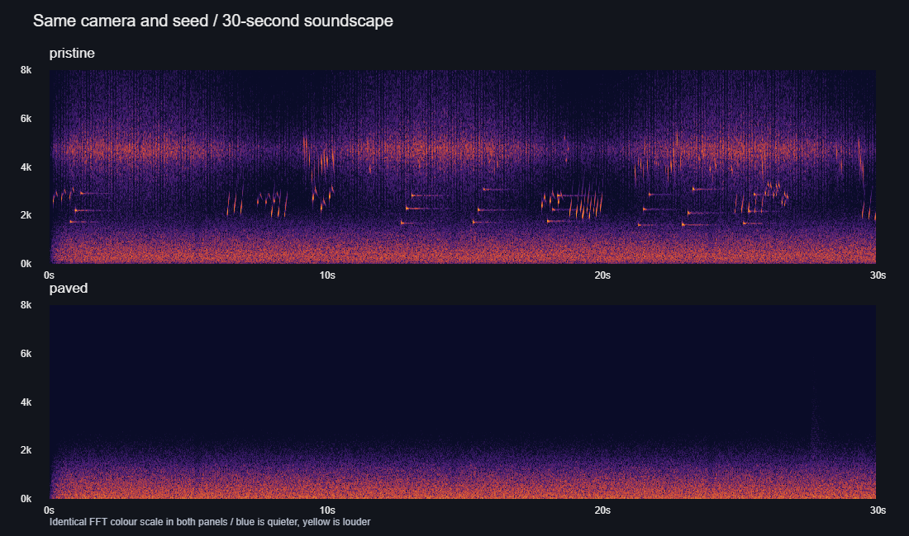
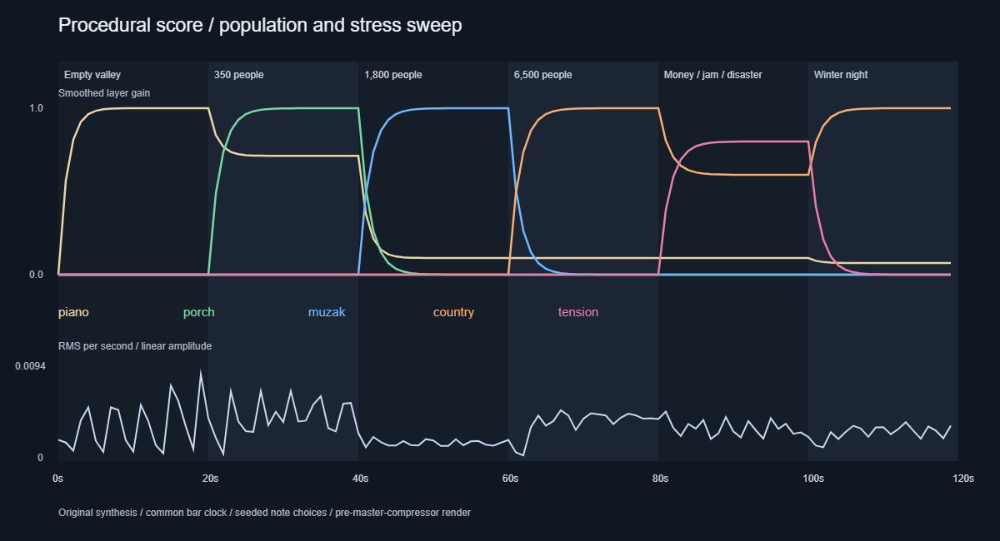

# Audio evidence

## A1 camera-local soundscape

Measured on 2026-11-17 with Chrome 157 on Windows. The source checks, seeded offline renders, TypeScript check, `audiotest` and all 17 `soundtest` assertions pass. I cannot audition audio in this environment. Perceptual balance and recognition await the owner's listening review.

### Runtime changes

- `Game.frame` samples the existing `fields.naturePct()` and `fields.pollutionAt()` every 0.5 seconds. Cars, people and active construction are distance-weighted within 200 m of the camera target. Sound inputs and actor records reuse fixed storage.
- Habitat uses the simulation reference trees, independent of graphics density. Full local habitat is 160 trees within 200 m. This tuning choice lets a clearcut camera neighborhood become quiet while most of the county remains forested. The tree sample is anchored to 32 m cells. A decrease in the same cell produces a six-second clearing envelope.
- The effective nature level is county nature × local habitat × `exp(-2 × pollution)`. Existing seasonal birds, frogs, insects and water beds use that level. Surf uses the existing water samples and coastal sand coverage.
- The nearest eight eligible, drawn, camera-visible actors can contribute calls. Gulls, pelicans, crows, small birds, sea lions and alligators use procedural voices. Three persistent engine slots follow visible moving fishing boats, bass boats and jet skis. Panning follows camera space. Boat motors and new actor calls stop on pause, with existing gain smoothing.
- Ambient phrases have an eight-phrase concurrency cap. The new chainsaw and leaf-blower phrases share it. Sound, reverb and Music retain their existing Settings controls. Existing camera-local street engines continue through `StreetAudio`.
- `Synth` accepts an injected random source. The game passes a local seeded generator, and the measured ambience path consumes zero global random draws.

### Real valley pair

`audio-valley` creates Holler County with world seed 271828 and pins one camera for both captures. It builds roads, zones and eight services through existing game entry points, clears reference trees and advances the actual simulation for 240 days. The two audio snapshots use summer, noon and clear weather. No field values are replaced in this scenario.

| Captured input | Pristine | Developed |
| --- | ---: | ---: |
| Population | 0 | 213 |
| Buildings | 0 | 67 |
| Road segments | 26 | 99 |
| Cars at capture | 0 | 28 |
| County reference trees | 232,331 | 214,698 |
| Trees within 200 m of target | 601 | 0 |
| Field nature | 1.0000 | 0.9223 |
| Field pollution | 0 | 0.08566 |
| Local traffic mix | 0 | 0.13237 |
| Local people mix | 0 | 0.11158 |
| Local habitat mix | 1 | 0 |

Camera position is `[-521.4838815211866, 106.91605555340934, 192.77608373625478]`, target `[-635, 10.086230635643005, 135]`, distance 160 m. Position, quaternion, target and distance match exactly between captures. The developed case is a small town with a cleared neighborhood and 7.8% county tree loss. No coastal actors are audible at this camera.

The captured mixes feed the actual `Ambience` class for 30 seconds each with audio seed 1776. The WAVs are stereo 24 kHz, 16-bit PCM. They hold each captured mix constant through an `OfflineAudioContext` render. These are steady-state snapshot comparisons. They exclude music, individual street-engine voices and the final master compressor. The ambience and reverb gains match the game's default master scaling.

| Measured output | Pristine | Developed |
| --- | ---: | ---: |
| Bird phrases / 30 s | 30 | 0 |
| All phrases / minute | 60 | 2 |
| Spectral centroid, 40 Hz–10 kHz | 1,954 Hz | 347 Hz |
| Energy below 250 Hz | 13.69% | 55.59% |
| Energy above 2 kHz | 41.88% | 0.096% |
| Integrated loudness | −46.4 LUFS | −49.9 LUFS |
| True peak | −31.1 dBFS | −38.9 dBFS |
| Peak linear amplitude | 0.02767 | 0.01125 |
| Global random draws | 0 | 0 |

The developed snapshot has one leaf-blower phrase. Its traffic contribution is a continuous bed, so phrase count measures discrete events separately from sustained energy. Loudness comes from the installed FFmpeg EBU R128 filter. The frequency-energy shift and lower bird density pass the scripted acceptance bounds. Human listening remains open.



### Focused regressions

| Check | Measured result |
| --- | --- |
| Pollution-only controlled pair | 30 → 6 bird phrases with unchanged nature |
| Frozen original pollution pair | 29 → 29 bird phrases, expected acceptance failure |
| Boat pan | 94.41% right-channel energy for pan 0.7 |
| Boat runtime nodes | 67 built, 67 after five seconds |
| Paused isolated boat | Peak and RMS both 0 |
| Source eligibility | Four visible species included, behind-camera, distant and night-hidden actors excluded |
| Hidden actor group | Zero eligible sources |
| Source storage | Same array and same eight records reused |
| Actor phrase stress | Maximum eight simultaneous phrases, peak 0.10877 |
| Local car moved 20 km away | Traffic mix 0.04161 → 0 |
| Local tree decrease 10 → 4 | Clearing envelope 0.5 |
| Controlled coast | Two sea-lion calls and seven gull calls / 30 s, −31.7 LUFS, −19.3 dBFS true peak |
| Clearing fixture | Four chainsaw phrases / 8 s |
| Noise continuity | All three 9.3-second loops pass seam checks, strongest rhythmic repeat 0.122 |
| Settings | All 17 assertions pass, including sound/reverb mute, separate Music, persistence and 44 px phone targets |

The original source already separated explicit synthetic nature and traffic inputs spectrally. The new regressions target pollution response, real camera-local inputs, source eligibility, boat motors and clearing voices. Controlled fixtures complement the game-derived valley pair.

### Reproduction and artifacts

Serve the current checkout on a free local port and set `BASE_URL` to that origin. `CHROME` can select the installed browser through the shared launcher.

```powershell
node scripts/look/audio-sources.mjs
node scripts/look/audio-valley.mjs
$env:MIX_FILE = 'shots/audio/game/mixes.json'
$env:TAG = 'game'
node scripts/look/soundscape.mjs
Remove-Item Env:MIX_FILE
$env:TAG = 'after'
node scripts/look/soundscape.mjs
node scripts/audiotest.mjs
node scripts/soundtest.mjs
```

`shots/audio/game/` contains the real mixes, WAV pair, spectrum and loudness reports. `shots/audio/after/` contains the controlled coastal, source, clearing and pause fixtures. `audio-sources` and `soundscape` are registered in the full tier. Town construction is registered as the measure-tier `audio-valley` scenario. The owner-facing listening pack is copied to `outputs/Audio/` in this task's workspace.

### Owner listening checklist

- Compare `valley-pristine.wav` and `valley-developed.wav` at the same playback volume. Check that the forest reads as living habitat and the developed view as a low traffic bed.
- Check bird phrases for repetition, sharpness and excessive cicada hiss over the full 30 seconds.
- In `coast.wav`, assess surf texture, gulls, sea-lion calls and engine balance. Check stereo placement on headphones.
- In `clearing.wav`, assess whether the procedural chainsaw is recognizable and its onset is comfortable.
- In `boat.wav`, check the motor's timbre and right-side placement. `boat-paused.wav` is an exact-silence control.
- In the game, change Sound and Music independently, pan between forest and roads, pause near a moving boat, and verify the transition by ear.

Further authored car-alarm and fireworks/gunshot events remain part of the event-driven sound work. This A1 evidence covers the field-driven health-bar transition, local traffic bed, clearing and visible coastal life.

## A2 adaptive procedural score

The existing felt piano supplies the common harmony and bar clock. Its standalone defaults remain 62 bpm by day and 56 bpm at night. `musictest` passes with 57 day notes and 31 night notes, every note in key, lowest MIDI 38, peaks 0.066 and 0.043. Composition randomness and timbre randomness use separate seeded sources in the game.

### Arc and controls

`AdaptiveScore` uses the existing `tierAt(population)` function. At 0 people the felt piano carries the score. Porch banjo and fiddle reach full gain at 150 people. Muzak blends in across the 350–1,100 population tiers. Country guitar, bass and percussion replace it across 1,800–4,200 people. A quiet piano layer persists. These are tuning choices for the original requested arc.

Banjo and guitar use short decaying string partials. Fiddle uses a bowed sawtooth voice with vibrato and a slower attack. Muzak combines triangle notes and held harmony. Country uses strummed chords, a bass line, melodic fills, kick, snare and hi-hat. The tension layer stays diatonic. Every pitched stem shares the piano's current major key.

Layer gain transitions use 1.5-second time constants. Tempo moves toward 62, 72 or 96 bpm across the arc, eased over four seconds. Cash below $5,000 adds tension, reaching full financial pressure at −$10,000. Jam pressure uses `1 - flowEma`. Disasters lower the accompaniment, add tension and slow tempo. Night reduces level and tempo. Winter and night halve the porch picking density and soften percussion.

The game passes population, cash pressure and `flowEma` through the reused sound mix. Hurricane intensity is available from live weather. The `disaster` event subscriber tracks concurrent kinds independently, preserving the remaining event when another ends. The current simulation source has no `disaster` emitter. FABLE's producer wiring remains necessary for the other disaster kinds.

Music keeps its existing on/off and volume controls, including independent operation while Sound is off. Paused simulation retains the existing continuing-music behavior. New voices are scheduled at bar boundaries. The ten offline cases allocate zero audio nodes on updates that schedule no bar.

### Measured stems and sweep

Chrome `OfflineAudioContext` renders stereo 24 kHz PCM with the default 0.8 master scaling and reverb. Measurements precede the master compressor. Isolated stem files retain their live score gains. LUFS comes from the installed FFmpeg EBU R128 filter.

| Render | Duration | Peak | True peak | LUFS |
| --- | ---: | ---: | ---: | ---: |
| Felt piano | 50 s | 0.04771 | −26.4 dBFS | −42.8 |
| Porch banjo and fiddle | 50 s | 0.01848 | −34.6 dBFS | −49.1 |
| Muzak | 50 s | 0.01533 | −36.3 dBFS | −53.3 |
| Country band | 50 s | 0.03731 | −28.6 dBFS | −44.8 |
| Tension | 50 s | 0.01044 | −39.6 dBFS | −52.2 |
| Radio jingle | 50 s | 0.01097 | −39.2 dBFS | −53.2 |
| Winter-night porch | 50 s | 0.01296 | −37.7 dBFS | −53.1 |
| Population and stress sweep | 120 s | 0.04565 | −26.8 dBFS | −46.0 |

The sweep moves through six 20-second states. They are empty valley, 350 people, 1,800 people, 6,500 people, financial/jam/disaster pressure, and winter night. It schedules 177 piano, 56 banjo, 14 fiddle, 63 muzak, 273 guitar, 42 bass, 30 tension and 8 jingle notes. All pitches pass the major-scale check. Measured bar tempos span 62–95.73 bpm. Maximum adjacent-sample change is 0.006741, below the 0.04 waveform gate. Listening remains necessary to assess perceived clicks and musical transitions.



The controlled winter-night porch schedules 48 banjo and 12 fiddle notes, compared with 112 and 28 by day. The mute fixture is exactly silent in seconds 25–30. Every offline case consumes zero global random draws. Timbre seed 1776 and composition seed `0x5c0a3` are independent. A repeated country render has an identical note/timing sequence. Fourteen of 2,400,000 PCM samples differ by one 16-bit least-significant unit due to browser DSP rounding. The repeat gate requires identical note sequences and a maximum one-unit PCM difference.

`score-state` exercises the actual reference-town `Game.frame` path at 781 people. It observes financial pressure 1, flow 0.1 and tension 0.6, with the simulation day held fixed. Concurrent disaster levels progress 0.8 → 0.4 → 0. Music remains active with Sound off and fades below 0.001 when Music is disabled. All 17 existing phone Settings checks pass with the adaptive score attached.

### Radio text handoff

Every sixteenth country bar becomes an original eight-note jingle. `AudioEngine.onRadioAd` supplies the matching text at playback time. The callback drops stale announcements after a long frame pause. FABLE owns displaying the text through the feed or an on-screen radio caption. The three authored lines are exported as `RADIO_ADS` in `src/audio/score.ts`.

- Dillo’s Mega Stop. One hundred pumps. One destination. Every exit.
- SLOP Home Loans. Build your future on the equity of your future.
- Freedom Motors. More truck for every square foot of driveway.

The score uses original synthesis throughout. No samples, speech service or dependency were added. Automatic feed display is pending the UI handoff.

### Reproduction and listening

```powershell
node scripts/look/score.mjs
node scripts/look/score-state.mjs
node scripts/musictest.mjs
node scripts/soundtest.mjs
```

`adaptive-score` and `score-state` are registered in the full tier. `shots/audio/score/` contains the WAVs, measured JSON and sweep figure. The owner pack includes the 120-second sweep, isolated stems and a five-second jingle excerpt beginning 39.4 seconds into the full jingle render.

- Listen to `score-sweep.wav` with the pictured 20-second boundaries. Assess whether the porch, commercial and radio stages are distinct and the transitions comfortable.
- Compare `score-porch.wav` and `score-winter-night.wav`. Assess picking density and bowed-string recognition.
- Check `score-muzak.wav` and `score-country.wav` for repetition, harshness and balance against city sounds.
- Check `score-tension.wav` for financial/disaster mood and `score-jingle.wav` for the station-break character.
- In the game, test Music off/on, Music volume and Sound off while music continues. Owner listening is still pending.

## A3 action vocabulary and positional feedback

The production audio graph now supports `playAt(kind, x, z, volume)`, a persistent `zonePaint(x, z, cells)` voice and `duck(seconds)`. Existing `play`, Settings and Music APIs remain usable. Position follows the current street-audio listener and camera-right direction, with distance attenuation and a distant-source cutoff.

Positional effects use 17 fixed stereo lanes, created at unlock, with pan rounded to the nearest 0.125. An event never allocates a routing panner or changes the pan of a still-playing effect. This bounds routing graph lifetime without relying on downstream garbage collection. Recipe one-shot nodes retain their existing scheduled stops. A 20-event positioned-build sweep creates zero additional panners; all 20 recipes play. Both centered and positional `notify`/`levelUp` requests duck music, including when Sound is disabled.

The typed event binder handles completed construction, demolition, building level-up, crash, zoning, positive income, weekly close, road creation, lane additions, tree clearing, final paving and collapse stages. Reinstalling the binder is idempotent. Existing milestone announcements keep their fanfare. Building level-up uses a quieter positional version. The error recipe now uses two short triangle tones, with 12–18 ms attacks.

The integrated simulation supplies real building completion, level-up, demolition, crash, road, lane, income and zoning events. Redundant direct completion, building-bulldoze, crash, road-build and lane-add sounds are removed. Undoing a placed building relies on its demolition event. Road demolition retains its positional callback because it has no typed demolition event; immediate landmark placement retains its distinct placement cue. The existing 35 ms same-kind burst guard continues to coalesce rapid sound requests.

The zone voice allocates its pink-noise source, filter, gain and panner during audio unlock. Successful paint updates retune and extend a 160 ms envelope. It fades on release, mute or Sound off. Repeated painting creates zero audio nodes. Feed display already plays `notify`, which now ducks Music to 0.45 and the ambience bus to 0.6. The attack is 60 ms, the default hold 1.6 seconds, and recovery uses a 450 ms time constant. Music and its reverb both duck. The banner hook is requested from the UI owner.

All SFX random choices now use the injected synth RNG. Street audio receives its own seeded RNG when the engine opens. The full action render consumes zero global random draws.

### Exact-once checks

`action-events` uses the integrated reference town (fingerprint `25ca9818`, fixture SHA-256 `600dee76f57a4efea7c31455ca17d5761518bbd66bfddf60f2be82d0d1710085`). It calls real building level-up and construction advancement, public building/road demolition, road creation and upgrade, finite income/spend, zone painting, traffic crash, weekly close and milestone paths. Each produces one relevant audio request. Advancing completed construction again and demolishing an already-removed building produce zero further requests. Calling the binder twice retains one listener per event. Typed payload tests remain separate coverage of the consumer contract.

| Live source | Requests |
| --- | ---: |
| Building level-up | 1 |
| Construction completion | 1 |
| Repeated completion tick | 0 |
| Building demolition | 1 |
| Repeated demolition | 0 |
| Road upgrade | 1 |
| Road demolition, including retry | 1 |
| Weekly close | 1 |
| Milestone | 1 |
| Finite income, followed by expense | 1 income cue |
| New road | 1 |
| Standalone zone paint, 30 changed lots | 1 |
| Actual traffic crash | 1 |

### Peak and graph checks

`action-audio` renders the actual `AudioEngine` graph through an `OfflineAudioContext`, including the master compressor and final peak ceiling. Background ambience and score scheduling are held inactive to isolate the action path. Ten cases pass, with zero nodes created by idle updates or paint updates. All 13 SFX recipes are rendered, followed by a simultaneous maximum-supported-volume stress case.

The stress case exposed a pre-existing compressor-attack overshoot of 1.10550 linear amplitude and +0.8 dBFS reconstructed true peak. A four-times-oversampled soft ceiling now preserves unity gain below 0.7 linear amplitude and rolls off higher excursions. The final render including the A4 tyre squeal peaks at 0.84414 and −1.2 dBFS true peak. The scripted gate checks both sample peak and measured true peak.

| Render | Peak | True peak | LUFS |
| --- | ---: | ---: | ---: |
| 22-second action montage | 0.77793 | −1.8 dBFS | −26.3 |
| All 13 recipes, separated | 0.67553 | −3.1 dBFS | −20.9 |
| All 13 recipes at volume 1.5 together | 0.84414 | −1.2 dBFS | −13.6 |
| Isolated positional build | 0.32193 | −9.8 dBFS | −29.3 |
| Zone-paint loop | 0.01500 | −36.4 dBFS | −46.4 |

The left-positioned build sends 0.179% of its energy to the right channel, and the right-positioned build sends 99.808%. The source 20 km away and the muted zone case both render exact silence. Paint audio reaches silence by the fourth second after the scripted two-second stroke. Notification Music gain measures 0.45013 during the hold and 0.98032 after recovery. TypeScript, registry lint and all 17 phone Settings assertions pass.

### Remaining producer integration

Live per-income and completed zone-stroke events are verified after integration. `zonePainted` fires at stroke completion, so it currently produces a short completion pulse. Continuous sound during a held brush still needs a progress hook. Generic banner ducking and the future collapse/final-paving producers remain integration work. The completed frame, event and controlled audio checks do not establish perceptual balance or physical-phone performance.

### Listening montage

`outputs/Audio/action-montage.wav` contains build at 1 s, bulldoze at 3 s, error at 5 s, cash at 6.5 s, milestone at 8 s, crash at 10 s, zone painting from 13–15 s and notification at 17 s. Individual spatial and zone clips are included. The maximum-volume stress render remains in the measured test folder.

- Assess whether build, demolition, cash, milestone and error are distinguishable and comfortable.
- Check left/right placement on headphones using `action-left.wav` and `action-right.wav`.
- Check `action-zone.wav` for continuity during the stroke and a smooth release.
- Test an actual feed notification with Music playing and listen for a natural duck and recovery.
- Review the peak ceiling during a busy action sequence in the game. Perceptual balance remains open for owner listening.

```powershell
node scripts/look/action-events.mjs
node scripts/look/action-audio.mjs
node scripts/soundtest.mjs
```

`action-events` and `action-audio` are registered in the full tier. Detailed measurements and the pre-ceiling failure are retained in `shots/audio/actions/`.

## A4 world sound set pieces

The normal frame loop samples real sources into four reused records at 4 Hz. Eligible sources are active, road-connected, allocated buildings within 300 m of the camera target. Intercom requires a drawn, unwrecked car in an actual drive-thru queue. Stadium sound follows the existing 17:00–22:00 event window. Church sound follows the existing 8:30–12:30 service window and additionally requires calendar Sunday: day 0 is Friday, March 20, 2026. Attendance schedules remain unchanged.

Four persistent world voices cover intercom gibberish, a crowd roar, and organ/bell tones; Low permits two active voices. At 900 m zoom distance, or while paused/muted/Sound-off, they fade and disconnect. Car stereo and reverse tones live inside the existing StreetAudio car voices and inherit their cap, distance, pan, Doppler and sleep routing. Passing lifted trucks use an original eight-note country figure; Cyberslops use wordless filtered murmur. Reverse beeps require both departure state and the renderer's actual reverse-lamp state. A reversing car has enough selection weight to qualify even when its idling engine would fall below the normal voice floor. No additional car voice pool exists. Real crash events add a falling tyre tone and scrape to the existing crunch. Moving emergency sirens retain their original implementation.

### Frozen real-source evidence

`world-sources` passed on Chrome 157.0.8103.51, ANGLE D3D11, NVIDIA GeForce RTX 5090, with integrated reference fingerprint`25ca9818`. The immutable source tree at`work/audio-a4-1794936822906` has SHA-256`a6d28e8645468cf2081dac30ce030e70161c21ee050b2a4a686101dba313b3d1` over 204 source/config files; the full manifest is`shots/audio/world/source.json`. Asset packs and dependencies are excluded from that source hash. The final radio/beeper Doppler follow-up passed the offline and existing street regressions from `work/audio-a4-1794936267247`, source SHA-256 `403a55ba8cb824e3e4140ba3e46e295d64f068cad6348e286aabee2596ffb271`; the final live-source run also includes this Doppler change and owns the manifest.

The reference fixture has no drive-thru model. The test adds one valid 4×4 commercial lot using the real generator and construction path, selecting Burger Baron variant 1 with 12 parking/queue spots. Traffic and parking then produce the sources themselves. Queue building 144 drives the intercom. SlopVan 1022 backs out of building 136 with its real reverse state. Passing liftedTruck 693, Cyberslop 866 and firetruck 909 retain matching voice IDs. The two landmarks are legally placed through the normal placement API and completed through construction. Unallocated, unfinished and disconnected landmark cases are rejected; Monday church and closed-hour cases are silent. Zoom, pause, master mute and Sound-off all reach zero world/street voices; resume restores two world voices on Low. The actual traffic crash requests exactly one positioned impact.

### Stems and limits

`world-audio` renders ten cases at 48 kHz for 12 seconds each. Every update allocates zero audio nodes and consumes zero global RNG draws. The controlled Low cap is two voices, and the sleeping stem reaches exact silence after its fade. These stems exercise the actual classes with controlled source positions; they are not microphone recordings of the live game.

| Stem in shots/audio/world | Sample peak | True peak dBFS | LUFS |
| --- | ---: | ---: | ---: |
| intercom.wav | 0.00758 | −42.4 | −58.7 |
| stadium.wav | 0.06040 | −24.4 | −39.9 |
| church.wav | 0.02696 | −31.4 | −49.6 |
| liftedTruck.wav | 0.11892 | −18.5 | −33.7 |
| cyberslop.wav | 0.03494 | −29.1 | −40.9 |
| reverse.wav | 0.04021 | −27.9 | −41.0 |
| wreck.wav | 0.44647 | −6.9 | −24.0 |
| siren.wav | 0.15269 | −16.3 | −26.2 |

The existing StreetAudio regression passes: its dense crowd peaks at 1.03019 before the limiter and 0.70220 after it, with 310 nodes before and after 32 seconds. The 1,900-car update benchmark averages 0.0305 ms/frame; scan-frame median 0.2 ms, p90 0.3ms, worst 11.9 ms under concurrent desktop load. These are desktop measurements, not physical-phone estimates. The full action output graph also passes after the added wreck components; its worst simultaneous effect peak is 0.84414 / −1.2 dBFS true peak.

HRTF remains disabled. In five alternating four-source 48 kHz / 12-second renders, stereo median was 429.7 ms and HRTF 866.8 ms, a 2.02× cost. Earlier runs ranged from 1.86× to 2.27×. Four-source update scripting averaged about 0.04–0.07 ms, but the offline rendering cost was substantial. HRTF is retained only as a comparison option in the isolated sound class; the game uses stereo on every preset. WebAudio processing is CPU work, and these results do not imply RTX audio acceleration.

All eight listening stems are copied to`outputs/Audio/world-*.wav`. `outputs/Audio/REVIEW_GUIDE.md` lists the A1–A4 stems under`shots/audio/` with focused mix questions. Intercom recognition/level, murmur recognition, church timbre and reverse-beep fatigue specifically need native audio and owner review. No perceptual acceptance is claimed. Physical-phone speaker quality, audio scheduling and battery cost remain untested.

```powershell
node scripts/look/world-sources.mjs
node scripts/look/world-audio.mjs
node scripts/streetaudio.mjs
```
