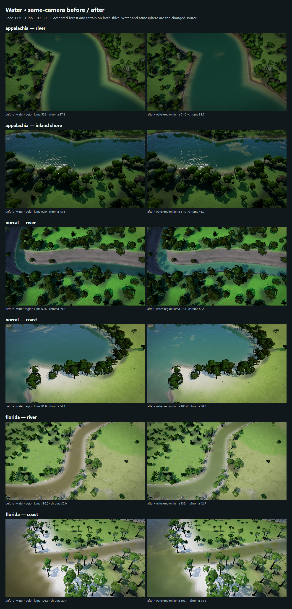
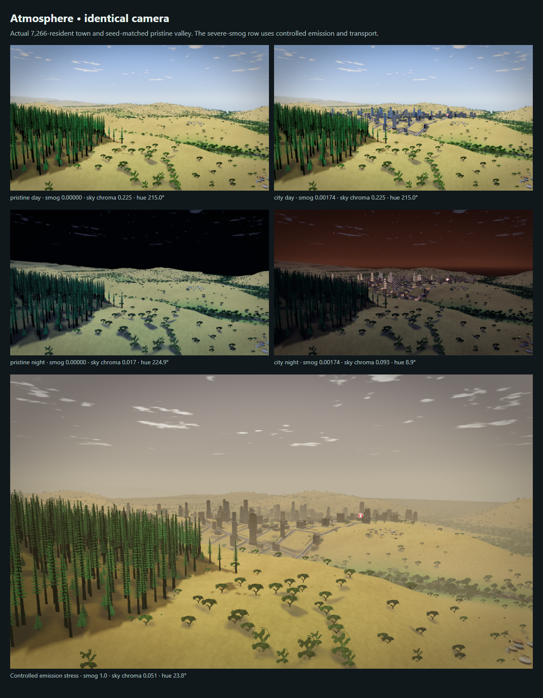
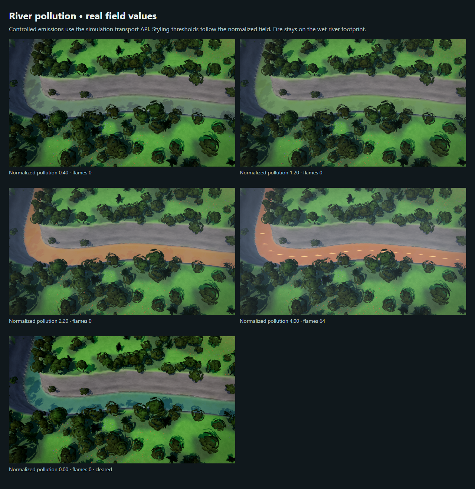

# Water and atmosphere

Water and atmosphere read the versioned world fields. The renderer preserves the heightfield and simulation state. The map comparisons use seed 1776, Chrome 157.0.8103.51 and NVIDIA RTX 5090 through ANGLE D3D11.

## Water

High and Ultra copy the resolved scene color and depth into a separate target. A water-only draw uses the retained scene depth. Exponential absorption preserves the shallow bed and strengthens the water color with depth. Florida has stronger inland absorption to retain its tannic bayou color. Foreground depth rejects distorted samples that would pull dry land into the water. The helper restores visibility, layers, shadows, auto-clear, target, viewport, scissor and background after normal draws and exceptions.

The pollution texture covers the same 96×96 cell centers as the actual field. Its normalized range is 0–4. Empty and NaN cells are clean. The texture uploads once per field version and keeps the same object across resizes.

Presentation colors progress through sediment brown at 0.08–0.7, algae green at 0.65–1.3 and acid orange at 1.5–2.5. Pollution above 2.6 adds flame ribbons at wet points along actual river paths. Flame strength reaches its maximum at 4. The pool holds at most 64 flames and clears completely when pollution clears. These thresholds are visual styling. Chemistry, disaster events and achievements remain separate simulation behavior.

Generated river paths supply flow direction. The carved beds have flat longitudinal floors. A visual surface rise of at most 0.28 m fades into wet banks and outlets. Shore foam follows the depth contour. Ocean shallows retain rolling surf. The county surface uses a bounded grid, with matching boundary vertices on the coarse distant-ocean strips. Terrain, navigation and flooding state stay unchanged.

| Preset | Mirror scale | Scene refraction | Dawn rays |
|---|---:|---|---|
| Low | None | None | None |
| Medium | 0.25 | None | None |
| High | 0.5 | Full buffer | Quarter buffer |
| Ultra | 1 | Full buffer | Quarter buffer |

Ultra mirrors use the full drawing buffer up to the GPU texture limit. Refraction has an optional pixel cap that defaults to 3840×2160. Live Low releases mirror, refraction and ray targets. Stationary mirrors retain their 30 Hz cadence.

## Atmosphere

The sky reads `fields.smog()` and the same local pollution texture used by water. Local pollution adds ground-level dust. County smog warms the dome, ambient sky, height haze and grade. A sun-facing fog term adds directional aerial perspective. Light pollution suppresses the Milky Way and raises the night horizon glow.

High and Ultra dawn/dusk rays sample depth at quarter resolution and add light before bloom. They skip noon, night and views with the sun hidden or behind the camera. Game and photo mode use the current camera and the same field-driven grade.

## Verification

`node scripts/waterunit.mjs` passes 26 checks. These cover field normalization, missing cells, version caching, zero RNG consumption across repeated updates, finite geometry, unchanged terrain, flow direction, bounded flame counts and clearing. The checks also cover exact reflection dimensions, stationary cadence, cleanup at three refraction failure points, separate copy targets, Low disposal and dawn/noon/Low ray behavior. Its middleware rig uses an isolated process cache and disables websockets.

The final map sweep passes 11 cases across three High river/shore pairs, three Low river views, a Medium river and an Ultra coast. Real emission and transport calls produce measured pollution values 0.4, 1.2, 2.2, 4 and 0. These are controlled field-source fixtures. All river-fire pools return to zero after clearing. The final portable seed hash passes a repeated NorCal High pollution and flame sweep. Full heightfield hashes remain unchanged. Page errors and WebGL errors are zero. Vite's failed attempts to forward ordinary ANGLE warnings over its disabled websocket are recorded separately.

The hardware optical fixture uses a white submerged plane. At depths of 0.5, 4 and 12 m, mean luma is 218.17, 148.19 and 28.22. The above-water foreground pole preserves 9,747 pixels with a maximum channel difference of 1. Color and depth copies are distinct from the active render target.

At a solar elevation of 3.507°, the dawn pass uses a 320×180 target. It adds 0.652 mean luma, with a maximum increase of 20.07, and changes 204,079 pixels by more than one luma value. Noon skips the pass. Live quality switching verifies High 640×360, Medium 320×180 and Ultra 1280×720 mirrors from a 1280×720 buffer. The CPU fixture additionally verifies a 2400×1200 Ultra mirror above the former 1400-pixel ceiling. Actual 4K verification is reserved for the final combined build.

All three `shoretest` runs pass. Mean sampled waterline-depth error is at or below 0.0001 m. The software moonless-houses probe passes with High luma 0.29917, Medium 0.28029 and Low 0.27968. Both differences stay within the 0.03 guard without lighting adjustments.

Final night regressions pass. `nightglow` records close-view luma 50.2 at night and 150.4 at noon, with zero white or amber specks. `yellowflash` records at most six pops in a frame against its 40-pixel guard and no WebGL errors. `nighttest` records road medians 90/74/68, lit-road p90 values 166/154/150, and zero blown-out pixels. Reports are retained in `shots/water/night-scripts-*.log`. Type checking and the registry lint pass.

## Matched map views

Both sides restore only `world/forestFloor.ts` and `world/terrain.ts` from accepted revision `c1efc1a`. The baseline restores water and sky from `9ec0de8` and removes their Game/photo bindings. The source manifests differ in those four files and the portable river-fire seed helper, which the baseline does not use. All six pairs have identical camera and terrain hashes. Appalachian shoreline views show its inland bank.

The water-region metrics below use fixed rectangles recorded in `comparison.json`. They describe the pixels in the contact sheet.

| View | Luma before → after | Chroma before → after |
|---|---:|---:|
| Appalachian river | 50.26 → 51.02 | 37.15 → 38.70 |
| Appalachian shore | 60.00 → 61.91 | 43.60 → 41.69 |
| NorCal river | 60.54 → 97.26 | 39.77 → 50.50 |
| NorCal coast | 91.84 → 103.44 | 54.30 → 58.55 |
| Florida river | 136.51 → 139.08 | 34.97 → 42.73 |
| Florida coast | 106.34 → 103.07 | 22.43 → 24.23 |

## Actual city and controlled smog

The city pair loads the immutable day-100 NorCal town with 7,266 residents and 284 buildings. Its seed is 1776 and its decompressed save SHA-256 is `e5b69e93f82bad59c50a10f4d5f3a5a38e2585c4cd480df68e4cdd8e9217e060`. Camera position and rotation are pinned exactly between the pristine and developed worlds.

The town has 227 polluted cells and maximum normalized pollution of 1.1823. Two cells exceed the county-smog threshold, yielding smog 0.0017361. Its daytime shift is small. Sky-band chroma moves from 0.22523 to 0.22506, with hue 214.98° to 215.00°. A naturally evolved city with visibly severe daytime smog remains unmeasured.

At night, actual-city light pollution is 0.31556. Milky Way strength falls from 0.48448 to 0.15515, and sky-band luma rises from 0.01281 to 0.09028. The separate controlled emission stress fixture reaches smog 1. Its sky-band hue reaches 23.84° and chroma 0.05119. The reports label the actual city and the stress fixture separately.

## Performance and remaining measurements

The Low proxy uses a 390×844 browser viewport with DPR 3 and 4× desktop CPU throttling. The preset clamps the actual drawing buffer to 585×1266. The map scripts record 90 synchronous CPU-work samples and eight disjoint-aware GPU samples. They report the water draw, texture copies, mirrors and dawn rays separately.

Concurrent desktop work produced large scheduler spikes. These measurements establish neither a budget pass nor a reliable speedup. The canonical 300-frame High1080, Ultra4K and Low4× measurements await the coordinated final combined build. Physical-phone measurement remains pending.

Full source hashes, pixel metrics, raw reports and review sheets are included in the Water-atmos output folder. The matched candidate is frozen at `work/water-after-1794945032884`. The baseline is `work/water-before-1794943680401`. `provenance.json` identifies the separate atmosphere, dawn and optics source snapshots.

The candidate source-list fingerprint is `6f8a548e7e40b79277daf8c348df2d9fe19bf1f56805cf6d1b67cd635475b8d8`. The baseline fingerprint is `f5745278eb7b9db9dc78fda3b043ff44b12d6be956802c04b424b6644180e159`. Each is SHA-256 of the JSON-encoded ordered file/hash list.
